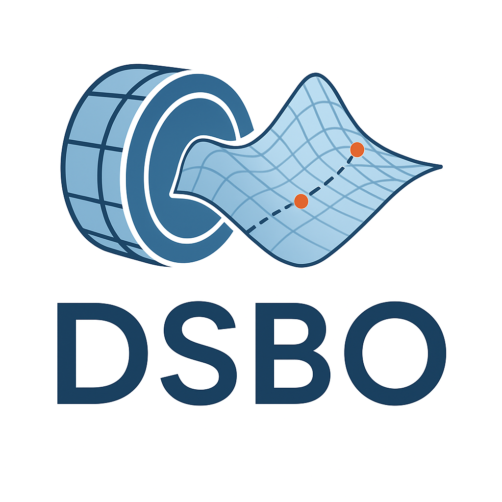

<h1 style="font-size: clamp(1.0rem, 5vw, 2.5rem);">dsbo - Surrogate-based Optimization  for Particle Detector Design</h1>
<br clear="left"/>


> [!WARNING]
> dsbo is prototype software! If you notice any issues or have any suggestions for improvements, please write up a GitHub issue detailing the problem or proposal. We also recommend “watching” the GitHub repository to keep track of new releases, and upgrading promptly when they occur.


## Getting started

```sh
pip install dsbo        #Full installation
pip install dsbo[aido]  #Partial installation of a subset of backends
```

```
git clone git@github.com:tobiaskortus/dsbo.git
pip install .
```

```
pip install git+https://github.com/tobiaskortus/dsbo
```

## Backend Support

To offer maximum flexibility in choosing different optimization frameworks and techniques, **dsbo** provides a pluggable backend architecture. This design allows users to select the underlying optimization engine that best fits their workflow, performance requirements, or experimental setup.

Backends in **dsbo** wrap external optimization libraries behind a unified interface, ensuring consistent usage patterns regardless of the chosen framework.

### Supported Backends

At the moment, **first-class backend support is still under active development**.  
Several components are functional, but full coverage of all features and optimization strategies is a work in progress.

### Experimental Backends

The following backends are available but considered **experimental**. They may not yet support the full feature set of dsbo and could undergo breaking changes:

- **RoDeO** — <https://github.com/eoezkaya/RoDeO>  
  A research-oriented optimization framework with a focus on flexible problem modeling and exploration algorithms.

- **AIDO** — <https://github.com/kylianschmidt/aido>  
  Integrated into unified surrogate interface provided by dsbo. 

- **Optuna** — <https://optuna.org>  
  A widely-used (hyperparameter) optimization framework offering efficient sampling strategies, pruning mechanisms, and integration with ML frameworks.

### Extending dsbo with Custom Backends

dsbo is designed to be easily extensible. Additional optimization frameworks can be integrated by implementing the provided **base backend interface**.

This allows developers to:

- expose new optimization engines through the unified dsbo API  
- leverage dsbo’s configuration, logging, and orchestration features  
- maintain interoperability with existing dsbo workflows

## License