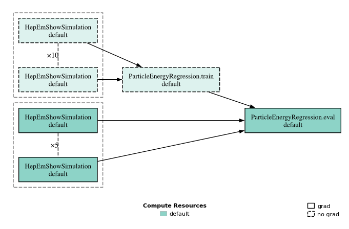

# HepEmShow: Differentiable Calorimeter Design

This example optimizes six longitudinal dimensions of a three-layer PbWO₄/liquid-argon calorimeter using reverse-mode differentiation through HepEmShow and a geometry-conditioned energy reconstruction. It includes direct gradient-based optimization and a diffusion-surrogate-assisted variant.

## Example overview

| Item | Detail |
|---|---|
| **Goal** | Minimize energy resolution for a three-layer PbWO₄/liquid-argon calorimeter |
| **Forward model** | [HepEmShow](https://hepemshow.readthedocs.io/en/latest/), powered by [G4HepEm](https://g4hepem.readthedocs.io/en/latest/) |
| **Design variables** | Three absorber thicknesses and three gap thicknesses, each in `[0, 50]` mm |
| **Differentiation** | Reverse-mode AD through the simulation and reconstruction |
| **Surrogate** | Optional conditional diffusion model with a local trust region |
| **Prerequisites** | dsbo, `pyHepEmShow`, the checked-in G4HepEm data file |

## Physical model

The geometry comprises three absorber/gap pairs with a transverse size of 400 mm and a $1\times1$ lateral readout. Reconstruction uses only the three active-gap energy deposits; absorber deposits are excluded.

The design vector is

\[
\theta = (a_1, a_2, a_3, g_1, g_2, g_3), \qquad 0 \le \theta_j \le 50\ \text{mm},
\]

where $a_i$ is the thickness of absorber layer $i$ and $g_i$ is the following gap thickness. The checked-in initial geometry is:

| Parameter | Initial value (mm) |
|---|---:|
| $a_1$ | 9.03 |
| $a_2$ | 10.45 |
| $a_3$ | 36.00 |
| $g_1$ | 37.16 |
| $g_2$ | 29.67 |
| $g_3$ | 27.50 |

The initial longitudinal depth is 149.8 mm; depths above 150 mm incur the penalty defined below.

## Simulation and reconstruction

Primary particles are electrons with kinetic energies sampled uniformly between 1 and 10 GeV. A full evaluation uses two independent simulation sets:

- **Training:** 10 replicated simulation tasks of 4,000 events, for 40,000 training showers.
- **Evaluation:** 5 replicated simulation tasks of 2,000 events, for 10,000 independent evaluation showers.

Each simulation records the per-event active-layer energy deposits, primary energy, particle labels, and design vector. Training and evaluation use independent random streams.

The reconstruction is a geometry-conditioned multilayer perceptron:

| Setting | Value |
|---|---|
| Input | Six design parameters plus three active-layer deposits |
| Architecture | Two hidden layers of 128 units, ReLU |
| Output | Reconstructed primary energy |
| Loss | Energy-weighted MSE, $\frac{1}{N}\sum_i (\hat E_i-E_i)^2/(E_i+1)$ |
| Optimizer | Adam |
| Learning rate | $10^{-3}$ |
| Weight decay | $10^{-4}$ |
| Batch size | 128 |
| Epochs | 10 |
| Validation fraction | 10% |

The best validation checkpoint is evaluated on the independent evaluation set. The reported metrics are weighted MSE, MSE, MAE, RMSE, and $R^2$.

In the direct workflow, each candidate gets its own reconstruction network trained on its own 40,000 training showers. In the batch-reduced workflow used by the surrogate, the training stage is fused across the candidate batch, so one network is trained on the pooled training showers. [Batch-Fused Workflow Stages](../guide/batch-fusion.md) explains why this is a different fitted-model objective, not merely a faster execution of per-candidate training.

## Objective

Let $\hat E_i(\theta)$ be the reconstructed energy for evaluation event $i$, $E_i$ its true energy, and $N$ the number of evaluation events. The objective is

\[
L(\theta) = \frac{1}{N}\sum_i \frac{(\hat E_i(\theta)-E_i)^2}{E_i+1}
+ \lambda \max(T(\theta)-150\ \text{mm}, 0),
\]

with

\[
T(\theta) = \sum_i (a_i+g_i), \qquad \lambda = 0.1.
\]

Box constraints are enforced by clamping the candidate tensor after each optimizer step.

## Workflow

The problem definition assembles the design space, initial candidate, and workflow:

```python
from examples.hepemshow.problem import HepEmShowCalorimeterProblem

problem = HepEmShowCalorimeterProblem("hepemshow", None)
candidate = problem.initial_guess(requires_grad=True)
workflow = problem.default_workflow
```



The training branch is wrapped in `with_no_grad`. Geometry gradients propagate through the evaluation reconstruction and reverse-mode HepEmShow.

!!! note "Frozen reconstruction weights"

    The reverse pass holds the fitted reconstruction weights fixed: it computes $\partial L(\theta,w)/\partial\theta$ at $w=w^*(\theta)$, omitting the response of the fitted weights to geometry, $(\partial L/\partial w)(\mathrm{d}w^*/\mathrm{d}\theta)$.

## Direct optimization

[`run_optimization.py`](https://github.com/tobiaskortus/dsbo/blob/main/examples/hepemshow/run_optimization.py) performs direct gradient-based optimization with RMSprop for 100 steps:

```python
import torch
from dsbo.utils.io import Workdir

optimizer = torch.optim.RMSprop([candidate.tensor], lr=1.0)

for step in range(100):
    with Workdir.create(f"files/example_hepemshow/step={step}", error_if_exists=False):
        optimizer.zero_grad()
        result = workflow.run(candidate)
        penalty = 0.1 * torch.clamp(candidate.tensor.sum() - 150.0, min=0.0)
        loss = result["loss"] + penalty

        loss.backward()
        optimizer.step()

        with torch.no_grad():
            candidate.tensor.clamp_(problem.LOWER_BOUND, problem.UPPER_BOUND)
```

The complete script records trials in SQLite and uses `HeterogeneousDaskWorker` for SLURM execution, with automatic fallback to local execution when SLURM is unavailable. Adjust the resource specification for your cluster:

```python
from dsbo.worker.spec import SLURMWorkerSpec

spec = SLURMWorkerSpec(
    cores=10,
    processes=1,
    memory="16GB",
    walltime="1:00:00",
    partition="epyc-256",
).adapt(0, 5)
```

See [Parallelization with Dask](../guide/parallelization.md) for resource configuration.

## Surrogate-assisted optimization

[`run_optimization_aido.py`](https://github.com/tobiaskortus/dsbo/blob/main/examples/hepemshow/run_optimization_aido.py) replaces repeated full-workflow evaluations with a workflow surrogate, following the AIDO framework [9]. The surrogate maps the six design parameters to the workflow objectives and is trained on results recorded from real evaluations:

```python
from examples.hepemshow.aido.strategy import CovarianceStrategy
from dsbo.surrogates.workflow_surrogate import DefaultWorkflowSurrogate

strategy = CovarianceStrategy(
    sigma=2.5,
    generate_scaling=1.0,
    trust_region_scale=0.8,
    num_candidates=20,
    seed=0,
)
surrogate = DefaultWorkflowSurrogate(
    strategy=strategy,
    max_epochs=100,
    batch_size=512,
    learning_rate=1e-3,
    patience=8,
    sample_count=512,
    num_workers=0,
)
problem.batch_reduced_workflow.patch(surrogate)
```

The ellipsoidal trust region starts isotropic at a scale of 2.5 mm and elongates along successive training-center displacements. Leaving the region triggers retraining on the current design and 19 perturbations, each with 400 training and 400 evaluation showers; reconstruction training is pooled across the batch.

The conditional diffusion surrogate uses 12 residual MLP blocks of width 256, DDPM training, and DDIM sampling with 512 samples per prediction. Adam optimizes the design for up to 8,000 steps at learning rate 0.2. Every ten steps, the full workflow evaluates the design with per-candidate reconstruction training, surrogates and caching disabled.

## Optimization settings

| Quantity | Direct optimization | Surrogate-assisted optimization |
|---|---|---|
| Forward model | HepEmShow, 3 layers, passive absorber | same; batch-reduced for training |
| Training showers | 40,000 per candidate | 400 per candidate; 8,000 per 20-candidate session |
| Evaluation showers | 10,000 per candidate | 400 per candidate; 10,000 per full check |
| Reconstruction | per-candidate geometry-conditioned MLP | batch-fused geometry-conditioned MLP |
| Optimizer | RMSprop, lr = 1.0, 100 steps | Adam, lr = 0.2, up to 8,000 steps |
| Surrogate | none | conditional diffusion, 512 samples |
| Trust region | none | ellipsoidal, 20 candidates, σ = 2.5 mm, τ = 0.8 |
| Full checks | every step | every 10 steps |
| Output | `example_hepemshow_*.db` | `example_hepemshow_aido_*.db` |

## Running the example

From the repository root, install dsbo and the Python wrapper:

```bash
python -m pip install -e .
python -m pip install "git+https://github.com/tobiaskortus/pyHepEmShow.git"
```

`pyHepEmShow` builds three native variants (`forward`, `forward_ad`, and `reverse`) and requires G4HepEm and its dependencies. Follow the [pyHepEmShow build instructions](https://github.com/tobiaskortus/pyHepEmShow#installation) and the [HepEmShow build documentation](https://hepemshow.readthedocs.io/en/latest/IntroAndInstall/install.html).

Run the direct optimization:

```bash
python -m examples.hepemshow.run_optimization
```

Run the surrogate-assisted optimization:

```bash
python -m examples.hepemshow.run_optimization_aido
```

Both scripts write timestamped SQLite studies in the current directory. Simulation and reconstruction files are staged under `files/example_hepemshow/step=<n>` or `files/example_hepemshow_aido/step=<n>`.

## References

1. HepEmShow documentation, https://hepemshow.readthedocs.io/en/latest/.
2. G4HepEm documentation, https://g4hepem.readthedocs.io/en/latest/.
3. S. Agostinelli et al., “Geant4—a simulation toolkit,” *Nuclear Instruments and Methods in Physics Research A* 506 (2003) 250–303.
4. M. Sagebaum, T. Albring, and N. R. Gauger, “High-Performance Derivative Computations using CoDiPack,” *ACM Transactions on Mathematical Software* 45 (2019).
5. D. P. Kingma and J. Ba, “Adam: A Method for Stochastic Optimization,” https://arxiv.org/abs/1412.6980.
6. J. Ho, A. Jain, and P. Abbeel, “Denoising Diffusion Probabilistic Models,” https://arxiv.org/abs/2006.11239.
7. J. Song, C. Meng, and S. Ermon, “Denoising Diffusion Implicit Models,” https://arxiv.org/abs/2010.02502.
8. pyHepEmShow repository, https://github.com/tobiaskortus/pyHepEmShow.
9. K. Schmidt et al., “End-to-End Detector Optimization with Diffusion Models: A Case Study in Sampling Calorimeters,” *Particles* 8 (2025) 47, https://doi.org/10.3390/particles8020047 (arXiv:2502.02152).
