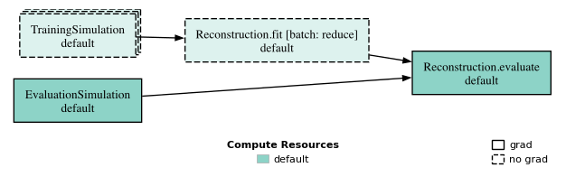

# Batch-Fused Workflow Stages

`batch_fuse()` wraps a module so that it runs once per nonempty candidate batch rather than once per candidate. Matching upstream files are combined into batch-wide inputs, and the stage's registered outputs are shared with downstream candidate tasks. Other stages still run once per candidate. The wrapper extends the [workflow composition API](workflows.md#batch-fused-stages).

## Example: Joint Reconstruction Model Training

Training a separate reconstruction model for every candidate can make simulation expensive: each design needs enough data to fit its own model. Batch fusion instead pools training data across candidates, fits one shared model, and evaluates that model separately for each candidate.

Pooling can reduce the amount of training data needed per design, but it changes the objective being evaluated. A model fitted across the batch need not perform like a model fitted independently for each design, and each candidate's score can depend on the other designs in its batch. Batch fusion does not itself reduce the number of simulated events; the simulation configuration determines that saving.

!!! note "Design-conditioned reconstruction"

    The shared reconstruction model should condition on the detector design so it can account for differences between candidates. Providing design features alongside the training samples and using them during training and evaluation is the user's responsibility; `batch_fuse()` does not add this conditioning automatically.

The following sketch uses two [dynamic submodules](module-templates-and-dynamic-submodules.md#module-with-dynamic-submodules) of one `Reconstruction` parent. It assumes an active [workdir](modules.md#module-with-file-io) and existing simulation modules whose `output` attributes are registered `Output` handles. Model fitting and evaluation are application-specific and left as placeholders.

```python
from dsbo.modules import Module, batch_fuse, dynamic_submodule, with_no_grad
from dsbo.utils.io import Input, Output, Workdir
from dsbo.workflow import Workflow


class Reconstruction(Module):
    def __init__(self, training_input, evaluation_input):
        super().__init__()
        self.training_data = Input(training_input)
        self.evaluation_data = Input(evaluation_input)
        model_path = Workdir.register_file("reconstruction", "model.pt")
        self.model_file = Output(model_path)
        self.trained_model = Input(model_path)

    @dynamic_submodule
    def fit(self, design, **kwargs):
        # Read self.training_data() and write the model to self.model_file().
        ...

    @dynamic_submodule
    def evaluate(self, design, **kwargs):
        # Load self.trained_model(), read self.evaluation_data(), return metrics.
        ...


reconstruction = Reconstruction(
    training_simulation.output.path,
    evaluation_simulation.output.path,
)
reconstruction_fit = batch_fuse(reconstruction.fit)

wf = Workflow(
    with_no_grad(training_simulation >> reconstruction_fit)
    | evaluation_simulation >> reconstruction.evaluate
    | reconstruction_fit >> reconstruction.evaluate
)
```

The three branches establish explicit dependencies: training simulations precede the shared fit, while each evaluation waits for both its own simulation and the shared model. Matching file declarations alone do not establish task order. Reusing `reconstruction_fit` in the dependency expressions refers to the same stage, not a second fit.

Both dynamic submodules share the parent's registered files. `model_file` and `trained_model` declare the same logical path: `fit` writes the checkpoint through the output handle, and `evaluate` loads it through the input handle. Each method resolves only the handles it needs during execution; the model is exchanged through a file, not through mutations to the parent instance.

`with_no_grad()` also excludes the training simulations from reverse execution. The evaluation branch remains available for differentiation if its modules implement the required backward operations.

!!! note "HepEmShow AIDO example"

    [`run_optimization_aido.py`](https://github.com/tobiaskortus/dsbo/blob/main/examples/hepemshow/run_optimization_aido.py) uses this pattern: `problem.batch_reduced_workflow` fuses `reconstruction.train` and runs `reconstruction.eval` once per candidate, while the full `problem.default_workflow` retrains per candidate. See [Surrogate-assisted optimization](../examples/hepemshow.md#surrogate-assisted-optimization); the AIDO framework is described by Schmidt et al. ([1](#references)).

## Fused Stage Semantics



For a batch of `N > 0` candidates:

| Stage | Calls | Inputs |
| --- | --- | --- |
| `training_simulation` | `N` | Each candidate's design |
| `reconstruction.fit` | `1` | Pooled training files and the first candidate's design |
| `evaluation_simulation` | `N` | Each candidate's design |
| `reconstruction.evaluate` | `N` | Each candidate's evaluation files, design, and the shared model |

The fused stage runs in the `batch_reduce` subdirectory. An empty batch executes no tasks.

!!! warning "The design argument is not batched"

    The fused call receives only the first candidate's decoded `design`, not a list or tensor of all candidate designs. If training needs design-dependent features for every sample, upstream tasks must write those features into the registered input files. Do not use the first candidate's values as if they described the whole pooled dataset.

## Reduced Inputs

Registered inputs are matched to upstream registered outputs by logical path. Files from ordinary upstream producers are combined in replica order, then candidate order; rows within each source keep their original order. Reduction is lazy: resolving an input handle such as `self.training_data()` builds the view when needed, and unused inputs are not opened.

The active file backend performs the reduction. HDF5 uses virtual datasets that reference the source files, so those sources must remain available. See [Combining Replica Outputs](io.md#combining-replica-outputs).

## Results and Gradients

The wrapped stage must expose at least one registered `Input`; for a dynamic submodule, the parent's registered inputs are used. `batch_fuse()` raises `TypeError` for non-module objects and `ValueError` for modules without registered inputs or modules that are already batch-fused.

A fused stage's returned metrics are discarded. A nonempty result dictionary produces a warning; metrics returned by ordinary downstream tasks remain candidate-specific workflow results.

`batch_fuse()` marks the wrapped module as reverse-mode no-grad. The reverse pass skips that stage and does not differentiate the shared fitting operation.

## References

1. K. Schmidt et al., “End-to-End Detector Optimization with Diffusion Models: A Case Study in Sampling Calorimeters,” *Particles* 8 (2025) 47, https://doi.org/10.3390/particles8020047 (arXiv:2502.02152).
