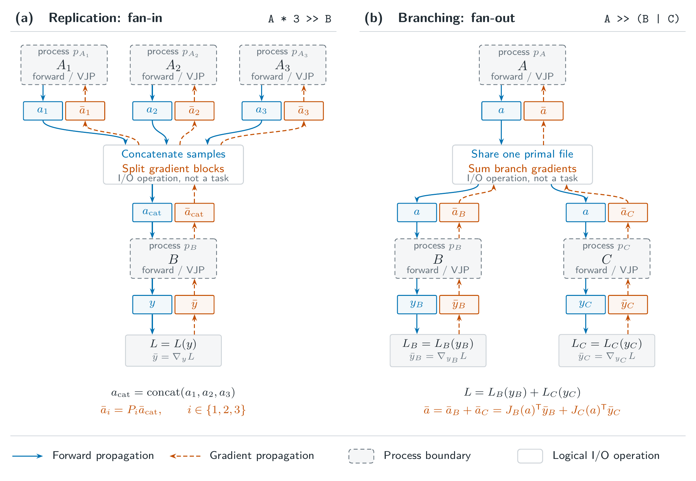

# Reverse and Forward Gradient Flow

Within a workflow, a producer module can feed multiple consumer modules (**fan-out**), or multiple replicas of a producer module can feed a single consumer module (**fan-in**).

In fan-out, each consumer contributes a gradient for the same file, and the producer module receives the sum of those contributions. In fan-in, the consumer reads a merged file, and its gradient is partitioned so that each producer replica receives the contribution corresponding to the data it wrote.

`dsbo` handles both routing patterns automatically for declared files. Each module simply reads its incoming gradients and writes its outgoing gradients through the declared handles, without managing gradient routing itself.

## Gradient Routing

### Gradient Aggregation and Partitioning

Each declared file acts as a gradient rendezvous point. Consumers write their contributions during backward, and dsbo aggregates them additively before the producer reads the file. For replicated tasks, dsbo records the size of each replica's output along the concatenation axis when it merges them in the forward pass. During backward, it uses those recorded sizes to split the merged gradient and routes each partition to the replica that wrote the corresponding output. A replica receives only its partition; the merged gradient is not broadcast.



### Partitioning and File Layout

The split follows the forward layout. Unnamed array datasets are concatenated along axis 0. For named-column tensors, columns occupy axis 0 and each column's samples are concatenated along axis 1. Each partition is reshaped to the original dataset shape of its source, including scalar outputs.

Nested merges are split recursively. If the same physical file appears more than once in a merged input, each occurrence produces a separate contribution, and the file receives their sum.

### Gradient Handles in `backward()`

`Input` and `Output` are symbolic declarations, not fixed paths. Calling `self.input()` or `self.output()` resolves the declared file against the active workdir, the candidate subdirectory, and the replica suffix. The same resolution applies in `backward()`, so a handle always refers to the file belonging to the current task instance.

| Handle | Role |
|---|---|
| `self.input()` | Forward input primal, `x` |
| `self.output()` | Forward output primal, `y` |
| `self.output.gradient()` | Incoming gradient to read, aggregated from downstream contributions |
| `self.input.gradient()` | Task-private outgoing gradient path to write |

For inputs, the runtime may resolve the handle to a merged view that combines several producer outputs; the view is materialized from the underlying files when the handle is resolved. For outputs, `self.output.gradient()` resolves the incoming adjoint, aggregated from the contributions written by downstream consumers.

`self.input.gradient()` allocates the task's outgoing gradient path. Repeated calls for the same input within a backward task return the same pending path. When the task finishes, the runtime validates the written gradient and routes it to the upstream producer. If the input is a merged replica view, the gradient is split by the recorded partition sizes before routing. The incoming path from `self.output.gradient()` is read-only.

These handles carry the candidate, replica, and merged-view context, so they must be resolved inside the running task. A module may register only one backward reader per input file, so open the file once and reuse the returned tensor.

### Computing a Gradient Contribution

`HDF5File.open` registers a post-accumulate gradient hook when gradient tracking is enabled. When the local backward pass reaches the opened tensor, the hook records a contribution for the input file. Python modules running in the same process therefore do not write gradient files explicitly: reopen the input, compute the local expression, and call `backward()` with the incoming gradient. [Implementing a Backward Pass](autograd.md#implementing-a-backward-pass) shows the pattern.

The hook records contributions only when the input is reopened and differentiated in the same Python process. Modules that delegate the computation to an external process or container must write the gradient through `self.input.gradient()` themselves; the hook cannot observe gradients across process boundaries.

A producer with no file inputs differentiates its local expression with respect to the design tensor and calls `backward()` with the output gradient. An objective with no output file seeds the input derivative from `grad_output`, for example `grad_output["loss"]`. A transform that depends on design directly propagates that design derivative in the same backward call.

!!! note "Python-only file interface"
    File operations are currently implemented only in Python through `HDF5File`. A general library for file operations is in development, so the HDF5 layout is not yet a stable external interface.

### Validation and Lifetime

The runtime validates gradient contributions when the backward task finishes. A missing or invalid contribution rejects the task's outputs, including other completed outputs from the same task. Primal files and any derivative checkpoints must remain available through the backward pass. 


## Forward-Mode Tangents

Forward-mode tangents follow a candidate's direction through the workflow. Attach a tangent with `set_tangent()` inside a dual level, run the workflow, and unpack the dual result. The file handoff is described in [File-Based Autograd](io.md#file-based-autograd).

The following snippet runs the two-module workflow from [Implementing a Backward Pass](autograd.md#implementing-a-backward-pass) with a unit tangent in the `scale` direction:

```python
import torch.autograd.forward_ad as fw

from dsbo.workflow import Workflow

candidate = Candidate.from_values(space, {"scale": 2.0})
response = ScaledResponse()
workflow = Workflow(response >> ResponseLoss(response.output.path))

with fw.dual_level(), Workdir.create("./workflow-jvp"):
    direction = torch.ones_like(candidate.tensor)
    dual_candidate = candidate.set_tangent(direction)
    result = workflow.run(dual_candidate)
    primal, tangent = fw.unpack_dual(result["loss"])

primal   # tensor(30.)
tangent  # tensor(30.), the directional derivative
```

`HDF5File.write()` saves a dual tensor's primal and tangent, and `HDF5File.open()` reconstructs the dual tensor inside the forward-AD context, so the tangent crosses the file boundary. A stage that writes only primal values does not propagate the tangent. External programs need their own forward derivative implementation; a reverse adjoint routine alone does not supply a JVP.
