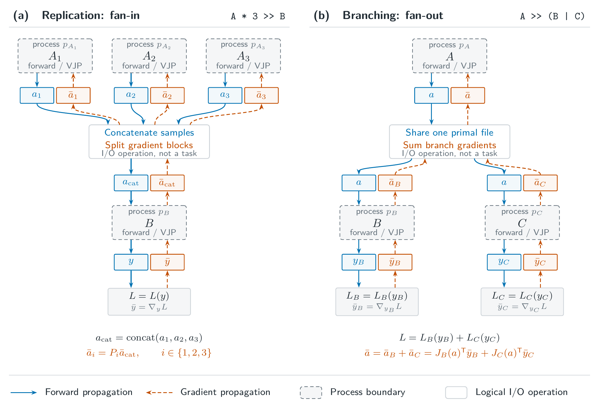

# Reverse and Forward Gradient Flow

Within a workflow, a producer module can feed multiple consumer modules (**fan-out**), or multiple replicas of a producer module can feed a single consumer module (**fan-in**).

In fan-out, each consumer contributes a gradient for the same file, and the producer module receives the sum of those contributions. In fan-in, the consumer reads a merged file, and its gradient is partitioned so that each producer replica receives the contribution corresponding to the data it wrote.

`dsbo` handles both routing patterns automatically for declared files. Each module simply reads its incoming gradients and writes its outgoing gradients through the declared handles, without managing gradient routing itself.

## Gradient Routing

### Gradient Aggregation and Partitioning

For a shared output, the producer receives the sum of its consumers' gradient contributions. For concatenated replica outputs, each replica receives only the gradient corresponding to the values it produced, not the full merged gradient. Modules use the same gradient handles in both cases.



### Replica Gradient Shapes

Replica gradients have the same shapes as their original outputs. For example, if replicas wrote `a` with shapes `(3, 2)` and `(2, 2)`, a consumer reads the combined `(5, 2)` value, while the replicas receive `(3, 2)` and `(2, 2)` adjoints respectively. For TensorDict values, this applies separately to each key.

Unused keys are omitted, not filled with zeros; explicitly computed zero gradients are retained. All-scalar TensorDict outputs combine into vectors, but each replica receives scalar adjoints with shape `()`. Do not mix scalar and non-scalar leaves within a TensorDict input, or combine plain tensor files with TensorDict files. See [TensorDict Storage](io.md#tensordict-storage) for the field and batch-shape rules.

The same rules apply when inputs combine outputs from several workflow stages. If one source file appears more than once in a combined input, its producer receives the sum of the contributions from all occurrences.

### Gradient Handles in `backward()`

`Input` and `Output` are symbolic declarations, not fixed paths. Calling `self.input()` or `self.output()` resolves the declared file against the active workdir, the candidate subdirectory, and the replica suffix. The same resolution applies in `backward()`, so a handle always refers to the file belonging to the current task instance.

| Handle | Role |
|---|---|
| `self.input()` | Forward input primal, `x` |
| `self.output()` | Forward output primal, `y` |
| `self.output.gradient()` | Incoming gradient to read, aggregated from downstream contributions |
| `self.input.gradient()` | Outgoing input-gradient contribution to write |

An input handle may refer to combined outputs from several producers. `self.output.gradient()` provides the incoming adjoint, summed across downstream consumers.

Write an external program's outgoing contribution to `self.input.gradient()` before `backward()` returns. Repeated calls for the same input within that task return the same path. Treat the incoming path from `self.output.gradient()` as read-only.

Resolve handles inside the running task. Open each input file once per backward task and reuse the returned tensor or TensorDict.

### Computing a Gradient Contribution

For Python computations, reopen the input with `HDF5File.open()` while gradient tracking is enabled, compute the local expression, and call `backward()` with the incoming gradient. The resulting input gradients are made available to upstream producers automatically, including gradients for individual TensorDict fields. You do not need to write gradient files explicitly. [Implementing a Backward Pass](autograd.md#implementing-a-backward-pass) shows the pattern.

Modules that delegate differentiation to an external process or container must instead have that program write its input gradients to the path returned by `self.input.gradient()`.

A producer with no file inputs differentiates its local expression with respect to the design tensor and calls `backward()` with the output gradient. An objective with no output file seeds the input derivative from `grad_output`, for example `grad_output["loss"]`. A transform that depends on design directly propagates that design derivative in the same backward call.

!!! note "Native gradient I/O"
    The standalone C++ `dsbo::io::HDF5Storage` API reads and writes workflow files compatible with Python's `HDF5File`. A native step can read the incoming adjoint and write its outgoing contribution without Python inside the executable or container. The [native I/O guide](native_io.md#use-in-a-dsbo-workflow) shows the path handoff and the [keyed gradient API](native_io.md#reverse-mode-gradients).

### TensorDict Adjoints

For a TensorDict file, `read_backward_gradient()` returns a TensorDict containing only the keys with contributions. Use `.get(key)` when a key may be absent; absence means no derivative was supplied, not a dense zero tensor. This distinction survives aggregation and replica partitioning.

```python
import torch

from dsbo.utils.io import Workdir
from dsbo.utils.io.storage import HDF5File

HDF5File.reset_gradient_state()
with Workdir.create("files/keyed_gradients"):
    path = Workdir.register_file("data", "values.h5")()
    HDF5File.write(path, {
        "a": torch.tensor([1.0, 2.0]),
        "b": torch.ones(2),
        "c": torch.ones(2),
    })
    values = HDF5File.open(path, device="cpu")
    loss = values["a"].square().sum() + 0.0 * values["b"].sum()
    loss.backward()

    adjoint = HDF5File.read_backward_gradient(path)
    print(adjoint["a"])      # tensor([2., 4.])
    print(adjoint["b"])      # tensor([0., 0.])
    print(adjoint.get("c"))  # None
```

In a fan-out, contributions are added by key. If one consumer differentiates only `a` and another only `b`, the producer receives both keys. If both differentiate `a`, that key receives their sum. A producer's backward implementation must account for missing keys rather than assuming every output leaf was used.

Use freshly opened inputs for each backward pass. For separate standalone file-autograd passes, call `HDF5File.reset_gradient_state()` before opening files for the next pass; workflow-managed passes do not require this call. Within a module's backward task, open each file once and combine the local expressions into one backward call.

### Validation and Lifetime

Required gradient contributions must be available when `backward()` returns; a missing or invalid contribution fails the task. TensorDict contributions may omit unused keys, but supplied keys must exist in the primal and match their original shapes. Keep primal files and any derivative checkpoints available through the backward pass.


## Forward-Mode Tangents

Forward-mode tangents follow a candidate's direction through the workflow. Attach a tangent with `set_tangent()` inside a dual level, run the workflow, and unpack the dual result. The file handoff is described in [File-Based Autograd](io.md#file-based-autograd).

The following snippet runs the two-module workflow from [Implementing a Backward Pass](autograd.md#implementing-a-backward-pass) with a unit tangent in the `scale` direction:

```python
import torch
import torch.autograd.forward_ad as fw

from dsbo.parameters import Candidate
from dsbo.utils.io import Workdir
from dsbo.workflow import Workflow

candidate = Candidate.from_values(space, {"scale": 2.0})
response = ScaledResponse()
workflow = Workflow(response >> ResponseLoss(response.output.path))

with fw.dual_level(), Workdir.create("./workflow-jvp"):
    direction = torch.ones_like(candidate.tensor)
    dual_candidate = candidate.set_tangent(direction)
    result = workflow.run(dual_candidate)
    primal, tangent = fw.unpack_dual(result["loss"])

primal   # tensor(30.)
tangent  # tensor(30.), the directional derivative
```

`HDF5File.write()` and `HDF5File.open()` preserve forward-mode tangents when used inside a forward-AD context. A stage that writes only primal values does not propagate the tangent. External programs need their own forward derivative routine; a reverse adjoint routine alone does not supply a JVP.

### Tangents Per Key

TensorDict tangents are also keyed. Fields without a supplied tangent remain ordinary tensors on read, and `fw.unpack_dual(field).tangent` returns `None`. A tangent must match its primal field's shape and dtype.

```python
import torch
import torch.autograd.forward_ad as fw

from dsbo.utils.io import Workdir
from dsbo.utils.io.storage import HDF5File

with Workdir.create("files/keyed_tangents"), fw.dual_level():
    path = Workdir.register_file("data", "values.h5")()
    a = fw.make_dual(torch.tensor([1.0, 2.0]), torch.ones(2))
    HDF5File.write(path, {"a": a, "b": torch.zeros(2, 2)})
    values = HDF5File.open(path, device="cpu")

    primal, tangent = fw.unpack_dual(values["a"].square().sum())
    print(primal)   # tensor(5.)
    print(tangent)  # tensor(6.)
    print(fw.unpack_dual(values["b"]).tangent)  # None
```

Native programs can read and write per-key tangents through `open_dict_tangent()` and `write_primal_tangent()`; see [Forward Tangents](native_io.md#forward-tangents).
