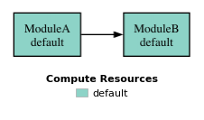
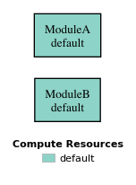
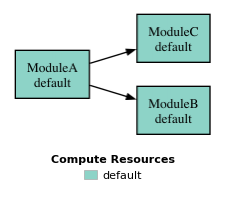
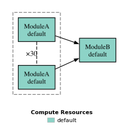
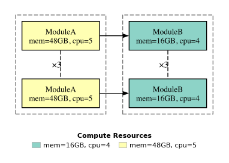
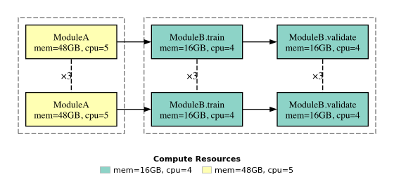
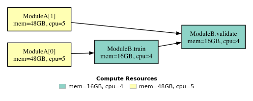
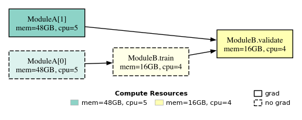

# Building Workflows

A **workflow** is a directed acyclic graph (DAG) of module tasks. Dependencies are declared with the operator DSL below; from the graph DSBO computes a topological task order, executes tasks with no dependency path between them concurrently, and schedules each task onto the compute resources declared on its module (see [Parallelization with Dask](parallelization.md)).

## Defining a Workflow

A `Workflow` wraps a task graph — a single module, or any composition produced by the operators below:

```python
from dsbo.workflow import Workflow

wf = Workflow(module_a >> module_b)
```

Evaluate it with `run()`: the graph executes once for the given candidate and the metric dictionaries of all tasks are merged into one result. The values are differentiable, so a result can be used directly as an objective in an optimization loop:

```python
result = wf.run(candidate)

result["energy_resolution"]   # metric of one task, differentiable
```

Batch evaluation uses `run_batch()`: the graph is traversed once for a list of candidates and a `ResultsBatch` is returned — one metric dictionary per candidate, plus column access per metric:

```python
results = wf.run_batch([candidate_1, candidate_2, candidate_3])

results[0]                     # metric dictionary of the first candidate
results["energy_resolution"]   # this metric for every candidate
results.tensor                 # all scalar metrics as a (n_candidates, n_metrics) tensor
```



The graph is stored as a `networkx.DiGraph` and validated at construction — cycles (`a >> a`) and duplicate module instances are rejected before any task runs.

## Composing Modules

Three operators cover the common patterns:

| Operator | Effect |
|---|---|
| <code>a >> b</code> | adds the dependency edge <code>a → b</code>: <code>b</code> runs after <code>a</code> |
| <code>a &#124; b</code> | <code>a</code> and <code>b</code> run independently; results are merged |
| <code>a * n</code> | replicates <code>a</code> into <code>n</code> tasks <code>a[0] … a[n-1]</code>, each with its own replica index |

Use `|` for independent evaluations whose metrics should end up in one result dict:

```python
wf = Workflow(module_a | module_b)
```



Chaining composes naturally — every operator returns a dependency dictionary that the next operator consumes. Branches merge the same way, so a stage can feed several consumers:

```python
wf = Workflow(
    (module_a >> module_b)          # ModuleA feeds ModuleB ...
    | (module_a >> module_c)        # ... and, independently, ModuleC
)
```



A replicated stage feeding a single consumer is a **fan-in** — every replica feeds the single consumer:

```python
wf = Workflow(module_a * 30 >> module_b)
```



Replicas paired with replicas are matched **one-to-one by replica index**. This runs three independent ModuleA-and-ModuleB pipelines — no cross-connections:

```python
CPU_CONFIG = SLURMWorkerSpec(processes=5, cores=5, walltime="48:00:00", memory="48GB", partition="epyc-256")
GPU_CONFIG = SLURMWorkerSpec(processes=1, cores=4, gpu_resources="gpu:1", memory="16GB", walltime="48:00:00")

wf = Workflow(module_a.to(CPU_CONFIG) * 3 >> module_b.to(GPU_CONFIG) * 3)
```



!!! note "Fan-in versus pairing"

    `module_a * 30 >> module_b` connects *every* replica to `module_b`. `module_a * 3 >> module_b * 3` pairs replica *i* with replica *i*.

!!! warning "Replicated modules must be stateless"

    Replicas are shallow copies that share mutable sub-objects and differ only in `.i`. Never rely on instance state surviving across replicas — treat modules as stateless.

## Per-Replica Subgraphs

To give every replica its own *multi-stage* pipeline, bind a subgraph to `dynamic()`. The subgraph is copied once per left-hand replica and wired by index:

```python
from dsbo.modules.dsl import dynamic

per_instance = (module_b.train >> module_b.validate) * dynamic()
wf = Workflow(module_a * 3 >> per_instance)
```



This scales to pipelines of any depth — the expression stays the same no matter how many stages follow each replica. Note that the stages of one pipeline share its single `module_a` run. When the stages need **individual runs** instead, replicate them and rely on the one-to-one pairing — three pipelines with a training and a validation stage need six simulations:

```python
wf = Workflow(module_a * 6 >> (module_b.train | module_b.validate) * 3)
```

The replicas are paired by index in stage order, so every `train` and `validate` stage consumes its own `module_a` run. The trade-off: the pairing form does not order `validate` after `train` — stages that depend on another stage's outputs (a trained model, for instance) should be chained in a bound subgraph as above, or given per-stage resources and explicit file dependencies.

## Dynamic Submodules

Large modules are easier to schedule when their internal steps are separate tasks. `@dynamic_submodule` turns a method into a first-class graph node that shares the parent module's files, configuration, and state:

```python
from dsbo.modules import Module, dynamic_submodule

class ModuleB(Module):
    @train_op
    @dynamic_submodule
    def train(self, design, **kwargs):
        model = fit_model(self.training_data())
        torch.save(model.state_dict(), self.model_file())
        return {}

    @dynamic_submodule
    def validate(self, design, **kwargs) -> dict[str, torch.Tensor]:
        model = load_model(self.model_file())
        return evaluate(model, self.validation_data())
```

The decorated methods are ordinary graph nodes, so you compose them with the same operators — including resource assignment per stage. The stages above each declare their own data inputs (`self.training_data()` for training, `self.validation_data()` for validation), so **each stage needs its own `module_a` run** — one producing the training data, one producing the validation data — and `validate` additionally depends on `train` for the trained model:

```python
wf = Workflow(
    (module_a.replicate(0) >> module_b.train)       # ModuleA run for the training data
    | (module_a.replicate(1) >> module_b.validate)  # separate ModuleA run for validation data
    | (module_b.train >> module_b.validate)         # validate loads the model train wrote
)
```



At runtime the submodules delegate to their parent: `module_b.train` runs the `train` method on the parent instance, so anything stored on `self` during `train` is visible to `validate` — provided both run in the same process. Like all modules, treat them as stateless across tasks and pass data through files instead (as the `model_file()` above does; see [I/O and Autograd](io.md)).

A few rules of thumb:

- **Split stages that need different resources.** Training on GPU while post-processing runs on CPU is only possible if they are separate tasks.
- **Split stages you want to re-run independently**, e.g. re-validating with a cached model without retraining.
- **Wrap training loops with `@train_op`** (stacked above `@dynamic_submodule`), as the `train` stage above does.

`TrainableModule` — the base class of all surrogates — uses the same mechanism for its lifecycle: its `train`, `pretrain`, and `finetune` stages are dynamic submodules, which is why `SurrogateBase` can be trained through the workflow (see [Writing Surrogates](surrogates.md)).

## Excluding Stages from Gradient Tracking

Stages that must not propagate gradients — a data-generation step in an otherwise differentiable pipeline, for instance — are marked with `with_no_grad`. It accepts a single module or a whole composition and flags every task in it. Applied to the training path of the workflow above, the `module_a` run producing the training data and the `train` stage are excluded from gradient tracking, while the validation branch and the model hand-off stay differentiable:

```python
from dsbo.modules import with_no_grad

wf = Workflow(
    with_no_grad(module_a.replicate(0) >> module_b.train)  # training path: no gradients
    | (module_a.replicate(1) >> module_b.validate)
    | (module_b.train >> module_b.validate)
)
```



## Batch-Fused Stages

Batch evaluation runs every stage once per candidate. Stages that operate on the batch as a whole — a model trained on all candidates' data, for instance — can instead be wrapped with `batch_fuse`. Such a stage runs **once per batch**: the inputs of all candidates are reduced into a single file (see [Combining Replica Outputs](io.md#combining-replica-outputs)), and the stage consumes them in a single call:

```python
from dsbo.modules import batch_fuse

wf = Workflow(module_a >> batch_fuse(module_b))
```

The wrapped module must register at least one `Input`, and its returned metrics are discarded — results flow through files, which the framework then makes visible to each candidate again. Like `with_no_grad`, batch-fused stages do not propagate gradients.

## Resource Annotation

Every module can carry a worker specification. Assign it with `.to()`, which returns the module and therefore composes with the DSL:

```python
from dsbo.worker.spec import SLURMWorkerSpec

CPU_CONFIG = SLURMWorkerSpec(processes=5, cores=5, walltime="48:00:00", memory="48GB", partition="epyc-256")
GPU_CONFIG = SLURMWorkerSpec(processes=1, cores=4, gpu_resources="gpu:1", memory="16GB", walltime="48:00:00")

wf = Workflow(module_a.to(CPU_CONFIG) >> module_b.to(GPU_CONFIG))
```

For local debugging, run the same workflow without any worker — DSBO executes it in-process:

```python
result = wf.run(candidate)   # no worker required
```

Distributed execution with Dask is covered in [Parallelization with Dask](parallelization.md) — the same workflow runs unchanged, with workers derived from these annotations.

## Inspecting Workflows

The task graph is a plain `networkx.DiGraph`, so it can be inspected directly:

```python
wf.task_graph
```

To render it as an image, call `visualize()` — each node is colored by its assigned resources:

```python
wf.visualize("workflow.png")
```
