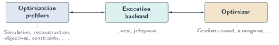

# Introduction

!!! warning "Work in progress"

    This documentation is still a work in progress. Sections may be expanded or restructured as it develops. Any feedback is appreciated.

dsbo is a modular Python framework for particle detector design optimization. It brings detector workflows, surrogate models, and optimization algorithms together to streamline research and benchmarking, from local development to evaluation at scale.

!!! warning "Prototype software"

    dsbo is prototype software and is still under active development; APIs and behavior may change. Report problems or suggest improvements through a [GitHub issue](https://github.com/tobiaskortus/dsbo/issues). For bug reports, include a minimal reproducing example, the dsbo commit hash, and the Python and dependency versions.

## Overview

dsbo provides a modular and extensible framework for combining detector simulation and reconstruction [workflows](guide/workflows.md), [surrogate models](guide/surrogates.md), and optimization algorithms. Its interfaces separate the detector-specific physics from the modelling and optimization choices, allowing new methods to be developed without restructuring the entire application.

{ width="100%" }

This separation reduces the integration work involved in detector-optimization research. A detector workflow can be defined once and reused with different surrogate models, training strategies, and optimization algorithms. Expensive evaluations are handled by a configurable [execution backend](guide/parallelization.md), so the same workflow can be developed and debugged locally and subsequently evaluated at scale with minimal changes to the problem and optimization code.

By making these components replaceable, dsbo supports systematic investigation of both surrogate modelling and optimization methods on common detector problems. Researchers can extend one part of a study while retaining the simulation, reconstruction, and evaluation setup, providing a shared basis for benchmarking rather than a fixed optimization recipe. The [HepEmShow example](examples/hepemshow.md) demonstrates this by applying direct and AIDO-style surrogate-assisted optimization to the same detector problem.


## Installation

dsbo is not yet available on PyPI. Install from a source checkout or directly from GitHub.

### Requirements

Python 3.10 or newer.

### Install from source

Clone the repository:

```bash
git clone https://github.com/tobiaskortus/dsbo.git
cd dsbo
```

Create and activate an environment using either `venv` or Conda, or use an existing environment.

**venv (POSIX shell)**

```bash
python -m venv .venv
source .venv/bin/activate
```

**Conda**

```bash
conda create -n dsbo python=3.12 pip
conda activate dsbo
```

Install dsbo into the active environment. For CUDA execution, follow [GPU support](#gpu-support) before this step.

```bash
python -m pip install .
```

For development, use an editable install instead. This uses the checked-out Python source directly, so changes to dsbo do not require reinstallation:

```bash
python -m pip install -e .
```

### Install from GitHub

To use dsbo as a dependency in other projects, it can be installed directly from GitHub without maintaining a local source checkout. The command below installs the current default branch into the active environment as a regular, non-editable package. A source checkout is used instead when dsbo is modified or the repository's example scripts are used.

```bash
python -m pip install "git+https://github.com/tobiaskortus/dsbo.git"
```

### Declare dsbo as a project dependency

dsbo can also be declared as a Git dependency in a project's installation configuration.

**requirements.txt**

The following line is added to the `requirements.txt` file:

```text
dsbo @ git+https://github.com/tobiaskortus/dsbo.git
```

Install the listed dependencies with `python -m pip install -r requirements.txt`.

**pyproject.toml**

For projects using Python's `pyproject.toml` metadata file, add the same reference to the existing `[project].dependencies` list:

```toml
[project]
dependencies = [
    "dsbo @ git+https://github.com/tobiaskortus/dsbo.git",
]
```

Installing a project with `python -m pip install .` also installs dsbo and the other declared dependencies.

To pin dsbo to a specific revision, append `@<full-commit-hash>` to the repository URL in either file, replacing the placeholder with the desired commit. A tag or branch name can also be used after `@`; without a revision, the default branch is used.

### GPU support

GPU support is optional; dsbo uses PyTorch for its tensor operations. If GPU modules are needed, install a CUDA-enabled PyTorch build before installing dsbo. Use the [PyTorch installation selector](https://pytorch.org/get-started/locally/) to choose the build that matches the operating system, Python version, and installed NVIDIA driver; this selects a CUDA version compatible with the driver rather than a fixed one. Without GPU modules, the default CPU build is sufficient.

On the machine that will run GPU modules, check that PyTorch can access CUDA:

```bash
python -c "import torch; print(torch.cuda.is_available())"
```

Module code must place its tensors and models on the GPU. When using Dask, also configure the [worker and module resource requirements](guide/parallelization.md) so GPU tasks reach suitable workers.

### Verify the installation

dsbo can be verified by importing it in the active environment:

```bash
python -c "import dsbo; print('dsbo import OK')"
```

Expected output: `dsbo import OK`.

For a functional check of workflow execution and gradients, run the [complete example](guide/gradient-based-optimization.md).

## Where to go next

- [Guide](guide/parameters.md): Start with Getting Started to define your design parameters, wrap simulation code in reusable modules, and connect them into a workflow. For a complete optimization loop, jump to [Putting It Together](guide/gradient-based-optimization.md), with examples using gradients or surrogate models. Use Advanced Topics when you need advanced execution patterns or API details.
- [Examples](examples/hepemshow.md): Apply these concepts to HepEmShow calorimeter optimization, including its external simulation dependencies.
- [Contributing](contributing.md): Set up a development environment, run tests, and contribute changes.
